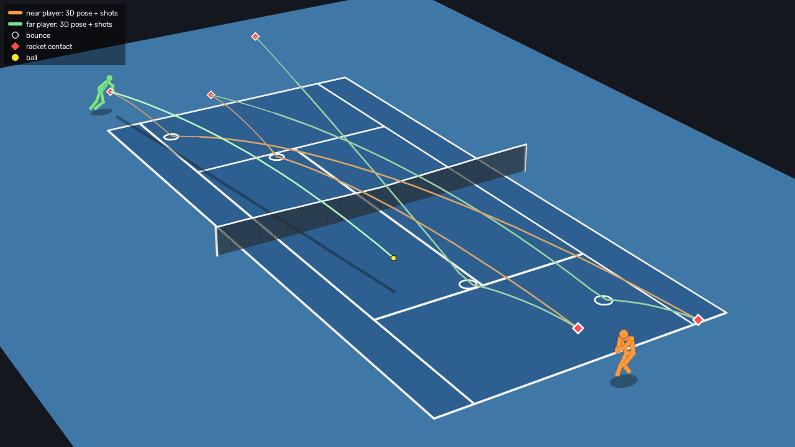
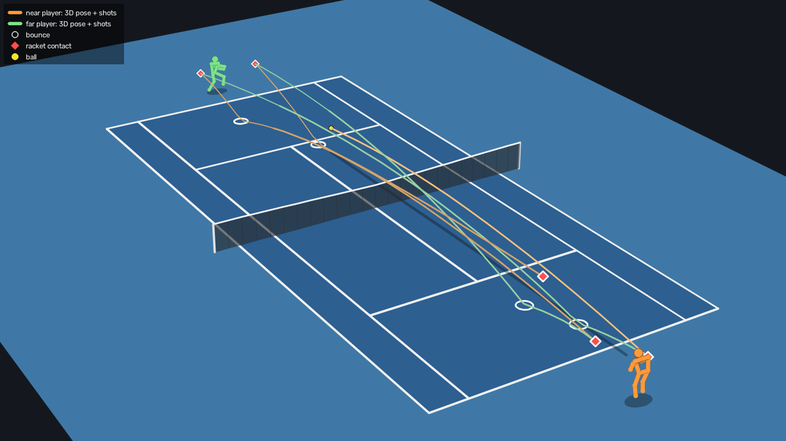
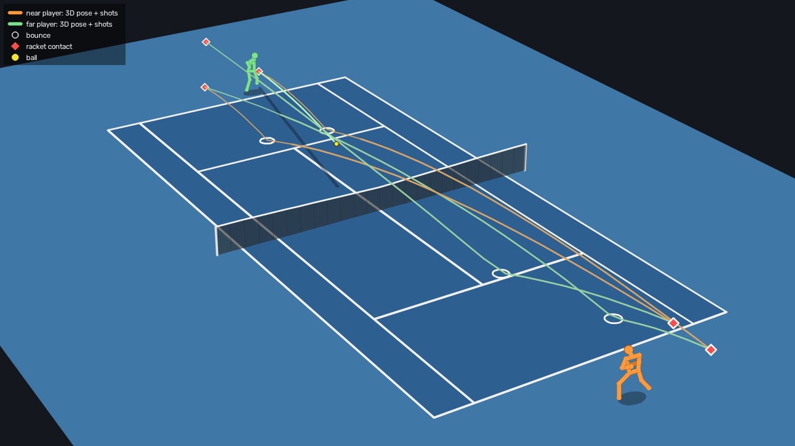
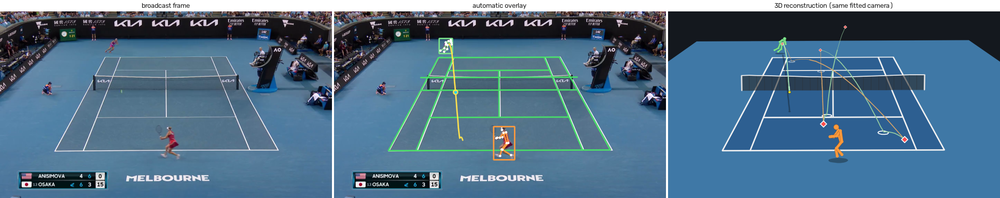
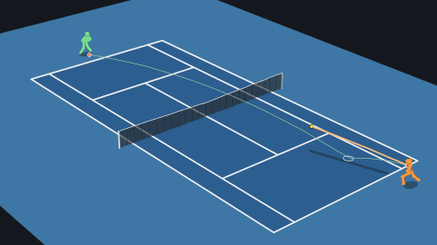

# OpenHawk: physics-based 3D tennis tracking from broadcast video

Automatic reconstruction of 3D tennis ball flights, events and 3D player poses from a single
ordinary broadcast video. A match video file goes in. Out comes, for every point the pipeline can
support, the fitted 3D ball flight between consecutive racket contacts and bounces, in metres in
the court frame, plus fitted 3D skeletons of both players. There are no labels, no manual steps
and no agent in the loop at inference.

This repository is the code release for the research paper *OpenHawk: Physics-Based 3D Tennis
Tracking from Broadcast Video*; OpenHawk is also the name of the released dataset. It contains
the automatic pipeline and everything it imports; research experiments are not included. It is
research code: it is written to be read and rerun, not packaged as a library. Released data will
be *processed outputs only* (3D flights, events, player poses, match metadata). No video is
distributed; the [samples](#samples) below are 3D renders of the output plus a few reduced
broadcast frames, one GIF and short clips, shown only to illustrate the output.

## How it works

```text
broadcast video (1080p; native frame timestamps kept end to end)
 │
 ├─ source check ....... full decoded-timestamp audit and repeated-frame (cadence) check;
 │                       a broken timeline is refused, never re-timed by guesswork
 ├─ S1 points .......... view classifier + serve detector + audio + scoreboard reading
 │                       → ledger of serve attempts / rallies with times and score
 ├─ S2 court/camera .... court-line topology → per-frame camera (homography + height)
 ├─ S3 players ......... person detection and 2D pose, near/far side association, court positions
 ├─ S4 2D ball ......... WASB + TrackNetV2 detectors (full frame, native far-court crops,
 │                       fine-tuned crop refinement), sub-pixel decoding, motion association
 ├─ S5 events .......... 3D-CNN video model over native crops + audio + track context
 │                       → racket contacts, bounces, net hits with sub-frame times
 └─ S6 3D fit .......... whole-point physical fit per rally: one ball, drag + Magnus flight with
     │                   a free 3-component spin per flight, measured court bounce law, net;
     │                   anchored on contacts and bounces; flight and point gates; abstains
     ├─ adjudication ... uncertain events are offered to the fitter and kept only if the
     │                   refit's physics gates accept them (no model call, $0)
     ├─ event beam ..... label-free contact candidates (audio onsets, detector peaks, track
     │                   gaps) refitted; a fit moves only if it gains flights and loses none
     ├─ assemble ....... MATCH_RESULT.json with two tiers per flight slot:
     │    ├─ validated:  gate-accepted flights after post-validation, the fit-only bounce
     │    │              rules (a fitted bounce no detector witnessed demotes the flight) and
     │    │              the post-fit checks (rally grammar, net clearance, scoreboard, reach,
     │    │              unused observations, physics); failing flights leave this tier
     │    └─ best effort: for every other slot, the fitter's own gate-failed state if it is
     │                   plausible, else a gravity arc through its 3D anchors, else nothing;
     │                   labelled and counted separately, never mixed with validated flights
     ├─ player names ... scoreboard rows + match metadata + end-change rules + serve sides
     ├─ pose ........... 2D keypoints on native player crops → 3D 17-joint skeletons for both
     │                   players on every frame of every exported rally (optimisation lift)
     └─ overlay ........ court, boxes, 2D skeletons, ball and fitted flights on the video
```

The physics is described in [docs/PHYSICS.md](docs/PHYSICS.md); the output format in
[docs/DATA_SCHEMA.md](docs/DATA_SCHEMA.md); how yield and accuracy are measured in
[docs/EVALUATION.md](docs/EVALUATION.md); model weights in [docs/MODELS.md](docs/MODELS.md).

## Samples

Every mark below is automatic output; nothing was labelled or corrected by hand.

**3D reconstructions** of rallies (our own renders, no broadcast pixels): the fitted ball
flights, contacts and bounces, and the fitted 3D skeletons of both players.



<p>


</p>

**Same camera, three views:** the broadcast frame; the automatic overlay (projected court,
player boxes, 2D skeletons, detected ball, events, reprojected fitted flight); and the 3D
reconstruction with skeletons rendered through the same fitted broadcast camera.





Short clips of one rally (8 s each, 640 px, H.264, no audio):
[broadcast with the automatic overlay](docs/samples/clip_overlay.mp4) ·
[3D reconstruction with both skeletons](docs/samples/clip_3d.mp4) ·
[overlay above the same-camera 3D view](docs/samples/clip_side_by_side.mp4).
In the renders the ball is drawn about twice its real size; skeletons are fitted 3D joints
(darker where a joint is low-confidence or filled across a short gap).

Broadcast frames and clips are the property of their respective rights holders and are shown in
reduced form solely to illustrate the research output. To request removal, open an issue.

## Where to start reading

| file | what it is |
|---|---|
| `cv/pipeline/product_runner.py` | one broadcast in, `MATCH_RESULT.json` out; the entry point |
| `cv/pipeline/broadcast_runner.py` | upstream stages S1-S5 and the shared S6 backend |
| `cv/pipeline/s6_broadcast_backend.py`, `s6_attempt_execution.py` | per-attempt 3D fitting |
| `cv/pipeline/product_s6_policy.json` | the production fitting policy (every switch explicit) |
| `cv/experiments/connected_shooting/` | the S6 whole-point fitter itself (search, seeds, gates) |
| `cv/pipeline/event_cascade.py`, `event_beam.py` | event adjudication (default: fitter, free) and the event beam |
| `cv/pipeline/flight_validation.py`, `fit_only_bounce_rules.py`, `post_fit_checks.py` | what keeps a fitted flight in the validated tier |
| `cv/pipeline/best_effort_tier.py` | the best-effort tier |
| `cv/pipeline/player_pose_3d.py`, `pose_lift_batched.py` | the 3D player pose step |
| `physics/flight.py`, `physics/bounce_reference.py`, `physics/impact.py` | flight ODE, measured bounce law, Cross slide/grip impact |
| `evaluation/origin_matcher.py` | the rule used to score reported yield |

`cv/experiments/connected_shooting/` and the other `cv/experiments/` folders here keep their
research-history names: the product path imports them directly, so they are included as far as
the product imports reach. [MANIFEST.md](MANIFEST.md) lists every included file with the reason
it is here, and every excluded group with the rule that excluded it.

## Install

Python 3.12+, `ffmpeg`/`ffprobe` on `PATH`, and a CUDA GPU for the upstream detectors
(developed on RTX PRO 6000 / RTX 5090 / RTX 3090 class cards). S6 fitting runs on CPU or, with
`TENNIS_S6_GPU_FIT=on`, on a GPU.

```bash
python -m venv .venv && . .venv/bin/activate
pip install -e ".[cv,dev]"   # dependencies only; install the torch build for your CUDA first
export TENNIS_DATA_ROOT=/path/to/tennis-data   # weights and outputs; run commands from the repo root
```

## Model weights

The authors' trained weights (event model, ball crop fine-tunes, Stage-1 view and serve heads,
serve-location prior; 233 MB) are assets of the GitHub Release
[`weights-v1`](https://github.com/maxsegan/openhawk/releases/tag/weights-v1), with a model card,
under CC BY-NC 4.0. Install them with checksum verification:

```bash
curl -fsSLO https://github.com/maxsegan/openhawk/releases/download/weights-v1/install_weights.sh
bash install_weights.sh      # needs TENNIS_DATA_ROOT
```

**Built with DINOv3:** the Stage-1 view head is trained on Meta's DINOv3 features and ships with
the DINOv3 License in the release.

Third-party weights (WASB-SBDT, Ultralytics YOLO and YOLO pose, torchvision, DINOv3, Qwen) come
from their own distributors under their own licences. The 3D pose step adds no trained weights.
[docs/MODELS.md](docs/MODELS.md) lists every weight, its SHA-256, where the code looks for it and
its licence.

## Run on a video

```bash
set -a; . ./production.env; set +a     # the production switches (optional; see the file)
python -m cv.pipeline.product_runner --video MATCH.mp4 --match-id KEY --surface hard \
    --out $TENNIS_DATA_ROOT/processed/runs/KEY --best-of 3 --gpu 0
```

Steps (`upstream`, `fit`, `cascade`, `refit`, `beam`, `assemble`, `portal`, `pose`, `compact`)
resume from their own markers; rerun the same command after an interruption. `--until fit` stops
after the first fits. `--max-points N` fits only the first N attempts (smoke runs). Nothing reads
evaluation labels (`MATCH_RESULT.json` records `evaluation_labels_read: false`).

Code defaults are the conservative rollbacks; [production.env](production.env) lists the
switches of the authors' production runs, each with what it does. Player names need a match
metadata table (`match_metadata/matches.csv` under `TENNIS_DATA_ROOT`: match id, winner, loser,
score); without it the viewer shows near/far.

In production (one machine with four GPUs, several matches at once) a match takes a median of
2.3 GPU-hours and 10.2 CPU-hours, and $0 in paid model calls with the default adjudication. The
paid VLM event cascade (Gemini Flash, then Claude Opus, via OpenRouter) is kept as a rollback
behind `--event-adjudication paid` with a hard dollar cap; it needs `OPENROUTER_API_KEY` in the
environment.

Tests: `pytest -q` (slow physics fits need `--runslow`). Unit tests use synthetic fixtures only.

## Results

### Sealed evaluation panels (flight recovery)

The unit is the **flight**: one ball flight between two events. A labelled flight counts as
recovered when the pipeline accepts a 3D flight whose start matches the labelled racket-contact
origin (one-to-one, within two native frame periods; [docs/EVALUATION.md](docs/EVALUATION.md)).
Abstentions, refusals and failures stay in the denominator. **AA** = automatic ball and automatic
events (the product). **AL** = automatic ball with labelled events (a ceiling for event
detection). Labels are development ground truth from frontier VLM labellers (see
docs/EVALUATION.md), not Hawk-Eye.

| population | status | code | AA | AL | wrong accepts |
|---|---|---|---:|---:|---|
| Panel F, 9 broadcasts, 7 processed | **sealed**, measured once, no tuning | 2026-09-28 | **90/136 (66.2%)** | 116/136 (85.3%) | 0 (plus 4 post-point flights, 5 origin offsets) |
| same, counting the 2 refused broadcasts as misses | sealed | 2026-09-28 | 90/167 (53.9%) | 116/167 (69.5%) | as above |
| Panel D, 9 broadcasts incl. grass | sealed, earlier code | 2026-09-27 | 79/172 (45.9%) | 141/172 (82.0%) | 2 (+4 origin offsets) |
| Panel C | sealed, earlier code | 2026-09-26 | 28/77 (36.4%) | 51/77 (66.2%) | 0 |
| Panel F again, with fitter adjudication | development (opened after the sealed run) | 2026-09-28 | 93/136 (68.4%) | — | 8 unmatched accepts (unclassified) |
| Panels 0+A, fitter adjudication | development (opened, tuned on) | 2026-09-28 | 116/174 (66.7%) | — | 2 unmatched accepts (unclassified) |
| First fresh hold-out, before the sealed-panel protocol | history | 2026-09-20 | 9/102 (8.8%) | 23/102 | 0 |

- **Sealed** means one measurement on broadcasts nobody had opened, with no reruns after
  results were seen. The three sealed panels were measured on successive code versions; they
  are not repeated draws of one system. A further sealed panel is reserved for the paper and has
  not been measured.
- Panel F refused 2 of 9 broadcasts by design (irregular frame cadence). Both rates are shown.
- "Wrong accept" is an accepted flight that matches no labelled flight and is not explained as
  a post-point flight (a player knocking a dead ball back, emitted but tagged `after_point_end`)
  or a correct flight whose start is offset from the label. Counting post-point flights as wrong,
  panel F has about 4 wrong per 90 accepted.
- Panel F labels were produced by Claude Opus 5.5. On panel C, Opus and GPT-6 Astra labels agreed
  on 97% of flight origins (75/77 recall, 75/79 precision).
- **This code is newer than every sealed measurement.** Changes since panel F (fitter
  adjudication, the event beam, the fit-only bounce rules, the post-fit checks, the best-effort
  tier, a shared camera centre per match, the bounce law refitted without the reserved
  Hawk-Eye matches) were measured on development and fresh panels only (below).

### Production (unlabelled broadcasts)

Read on 2026-10-12 from the authors' production tracker (data generated 2026-10-12 07:32
US Eastern). Production broadcasts carry no labels, so these are output counts, not accuracy.

| measure | value | denominator | status |
|---|---:|---|---|
| matches processed | 372 (3 with no flights) | 385 finished (13 failed) of a 2,168-match queue | production |
| validated flights | 198,854 | 372 matches | production |
| validated yield | 51.5% | flight slots of 76,790 serve attempts | production |
| extended yield (validated + best effort) | 61.6% | same, 369 matches | production |
| complete points, validated | 13,686 (17.8%) | 76,790 serve attempts | production |
| complete points, extended | 17,698 (23.0%) | 76,790 serve attempts | production |
| 3D player pose coverage | 99.5% | player-frames in active play with a player box, 363 matches | production |

- **Yield** here is (share of attempts with at least one flight of the tier) × (that tier's
  flights / flight slots of those attempts). A **complete point** has every flight from the
  serve to the end of the point in ONE connected fit; pieces of a point do not count. The
  denominator is serve attempts (a point with a first-serve fault has two).
- Most matches were processed before the fit-only bounce rules became part of the pipeline;
  312 of them were re-tiered afterwards with the same frozen rules (2,734 flights demoted). The
  post-fit checks have been on since 2026-10-11, so most production matches ran without them.

**Wrong accepts in the validated tier**, estimated on fresh panels (production matches drawn
before any output was read, judged by two independent VLM judges on rendered audits; not
sealed):

| change | panel | wrong accepts, without → with | cost | status |
|---|---|---|---|---|
| fit-only bounce rules | 8 matches, 1,234 points | 66/119 (55%) → 7/119 (5.9%) among validated flights with a fit-only bounce | validated yield 54.7% → 53.0%; complete points 265 → 239 (22 of the 26 removed judged wrong) | fresh panel; on in production since 2026-10-10 |
| post-fit checks (rules above on in both arms) | 7 matches, 1,034 attempts | about 8.6% → 8.3% of all validated flights (≈177/2,064 → ≈171/2,048; from 60 sampled flights, 5 wrong, Wilson 4-18%) | validated yield 43.8% → 43.2%; complete points 201 → 200 | fresh panel; on in production since 2026-10-11 |

So roughly one validated flight in twelve is estimated wrong on these panels when both judges
agree (about one in seven if either judge suffices). This judges every validated flight's 3D
path visually, a stricter test than the sealed panels' unmatched-origin count, and the rates are
not comparable.

## Limitations

- **Monocular broadcast video.** Depth comes from the physics and the court/net geometry, and a
  gate-accepted fit is not certified 3D truth. What has been validated (details and sources in
  [docs/EVALUATION.md](docs/EVALUATION.md#3d-accuracy)):
  - *Synthetic:* from idealised inputs (exact event frames and cameras, a matching physics and
    bounce model, ball centres with 2 px noise), the fitter recovers 744/744 flights of 240/240
    simulated points (40 points × 6 noise draws) within tolerance, with path RMS error median
    3.2 cm and p90 9.3 cm.
  - *Bounce law:* fitted on 2,427 Hawk-Eye impacts from 192 matches with all 51 matches reserved
    for comparison excluded; every coefficient is within 0.5 bootstrap standard deviations of
    the fit on all 2,616 impacts.
  - *Against Hawk-Eye on 25 matches* (validated flights; 16 never inspected during development):
    bounce position error median 0.19 m, p90 0.60 m (5,711 bounces); net-crossing height median
    absolute error 8 cm (5,828 crossings); hit height biased +11 cm (median, 5,455 hits). These
    were measured with the earlier per-point cameras; on a 5-match A/B the shared camera centre
    used in production lowered the net-height error from 9.8 to 6.3 cm and the hit-height bias
    to +7.9 cm.
  - The full point-by-point comparison against Hawk-Eye on the 51 reserved matches has not been
    run.
- **Racket impacts are not modelled physically:** each flight starts free at a contact anchor.
  The Cross racket impact model (`physics/impact.py`) exists and is used only as a feasibility
  check on candidate contacts; physically modelled contacts are under study.
- Production bounces keep the incoming horizontal heading (Hawk-Eye shows sub-degree median
  lateral deflection); a 3D Coulomb bounce in which sidespin turns the rebound exists but is off.
- The per-flight rifle-spin component is weakly identified and often sits at its bound; fitted
  spin should be treated as a fitting parameter, not a measurement (docs/PHYSICS.md).
- Grass bounce parameters come from 11 impacts; the Hawk-Eye corpus has no grass.
- **Player pose is fitted, not measured.** Both players get a 3D 17-joint skeleton on about
  99.5% of in-play frames where a player box exists (pose step, in production since
  2026-10-05; earlier matches have none), and the players are named from the scoreboard, match
  metadata and end-change rules (named directly or by propagation on 84% of production
  attempts; the rest stay near/far). Limits: the 3D comes from a single camera with stature,
  ground, upright and smoothness priors, not from a learned lifter; the far player is about
  90 px tall, so its depth comes mostly from the priors; forearm and knee depth can flip sign;
  serve jump height is understated; wrists and elbows blur; 9-14% of joints are missing in
  active play; an upstream box on the wrong person (umpire, ball kid) gives a wrong skeleton;
  there is no racket and no contact constraint. The pose audit is development-only (40/40 frames
  on the right player, 37/40 with plausible limbs).
- Broadcasts with irregular frame cadence are refused. Scoreboard reading needs a local VLM and
  abstains on some broadcasts.
- **Event detection is the main loss** (AA vs AL above); the event model was trained on 38
  broadcasts.

## Not in this repository

Videos, frames and any broadcast images other than the reduced samples; model weights (release
assets, see docs/MODELS.md); human and VLM labels; the evaluation-panel harness and panel data;
the authors' batch, storage and monitoring tooling; internal experiment logs. Candidates for
release on request are listed in docs/MODELS.md and docs/EVALUATION.md.

## Trademark

Hawk-Eye is a registered trademark of Hawk-Eye Innovations Ltd. OpenHawk is an independent
project and is not affiliated with, sponsored by, or endorsed by Hawk-Eye Innovations.

## Licence and citation

OpenHawk is free for non-commercial use.

- **Code** (everything in this repository that is software) is licensed under the
  [PolyForm Noncommercial License 1.0.0](LICENSE): use, change and share it for any
  non-commercial purpose, including personal research, teaching and work at non-profit,
  educational and public research organisations.
- **Documentation, images, sample clips, released data and the authors' model weights** are
  licensed under [Creative Commons Attribution-NonCommercial 4.0 International](LICENSE-DOCS)
  (CC BY-NC 4.0): share and adapt them for non-commercial purposes with attribution. The Stage-1
  view head is also under the DINOv3 License.

Third-party code, runtime
dependency and model licences are listed in [NOTICE](NOTICE); they are not changed by the above.
The player and pose detectors come from the Ultralytics package, which is AGPL-3.0 and is
installed separately under its own terms. Cite with [CITATION.cff](CITATION.cff).
